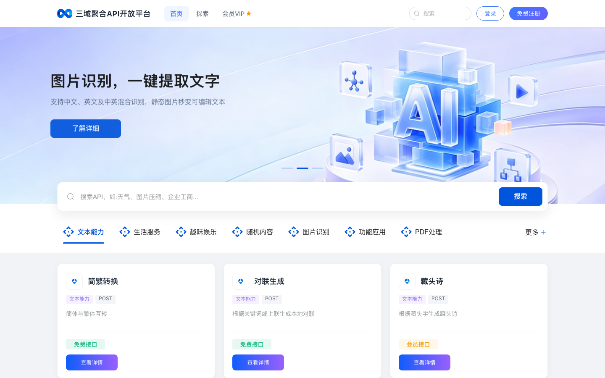
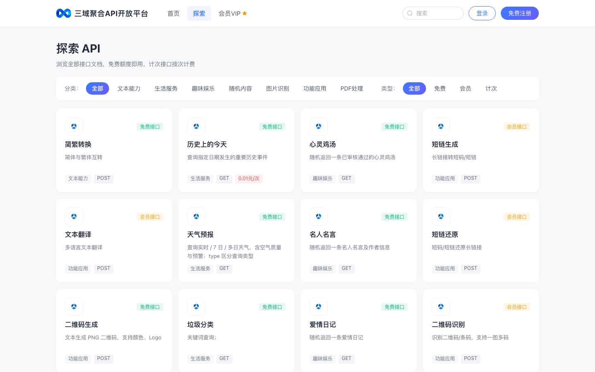
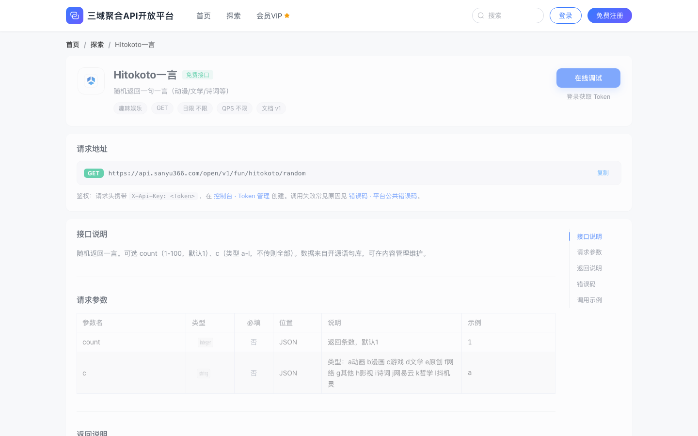

# sanyu-open-web-demo

三域开放平台的**门户前端**开源演示。用 Vue 3 浏览接口、阅读文档、在线调试；默认连线上环境，本地不必起后端。

[](./LICENSE)
[](https://vuejs.org/)
[](https://vitejs.dev/)

在线体验：[https://www.sanyu366.com](https://www.sanyu366.com)

## 界面预览

### 首页



### 探索 API



### 接口文档



## 快速开始

```bash
# Node.js 18+
npm install
npm run dev
```

浏览器打开 `http://localhost:8081`。开发代理默认指向线上文档站，装好依赖即可预览。

> 若需自定义代理目标，复制 `.env.example` 为 `.env.development` 后修改。

### 环境变量

| 变量 | 说明 | 默认 |
|------|------|------|
| `VITE_PROXY_TARGET` | 开发时 `/api` 代理目标 | `https://www.sanyu366.com` |
| `VITE_PROXY_STRIP_API` | 是否去掉路径前缀 `/api`（仅本地无前缀后端需要） | `false` |
| `VITE_DEV_PORT` | 开发端口 | `8081` |

## 功能一览

| 能力 | 说明 |
|------|------|
| 接口浏览 | 分类 / 免费·会员·计次筛选，卡片与搜索 |
| 接口文档 | 请求地址、参数、返回说明、错误码、调用示例 |
| 在线调试 | 粘贴 `X-Api-Key` 后在文档页直接试调 |
| 用户控制台 UI | Token、调用日志、安全设置等页面结构 |

本仓库**只有前端**。登录、额度、计费等能力由后端提供。

## 调试 Token

开放接口调用需要 AccessKey（请求头 `X-Api-Key`）：

1. 打开 [文档站](https://www.sanyu366.com) 注册 / 登录  
2. 在控制台创建 Token  
3. 粘贴到本仓库文档页的「在线调试」面板  

仓库内不包含任何真实 Key。

## 技术栈

- Vue 3 · Vite · Element Plus  
- Pinia · Vue Router · Axios  

## 目录结构

```text
src/
  api/           # 门户与调试请求
  views/         # 首页、探索、文档详情
  console/       # 用户控制台页面
  components/    # 调试面板、FAQ 等
public/          # 静态资源
docs/screenshots # README 截图
deploy/          # Nginx 配置示例
```

## 构建与部署

```bash
npm run build
npm run preview
```

产物为静态文件。生产环境请将 `/api` 反代到对应后端，可参考 `deploy/nginx-portal.conf.example`。

## 说明

- 这是前端演示仓库，不含管理端、开放 API 网关与数据库脚本。  
- 默认连接线上仅为方便本地预览；请勿对线上做压力测试。  
- 完整接口目录与额度说明以 [文档站](https://www.sanyu366.com) 为准。  

## License

[MIT](./LICENSE)
